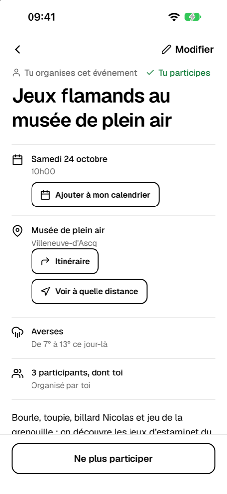
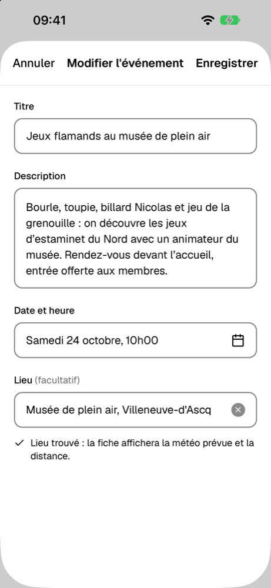
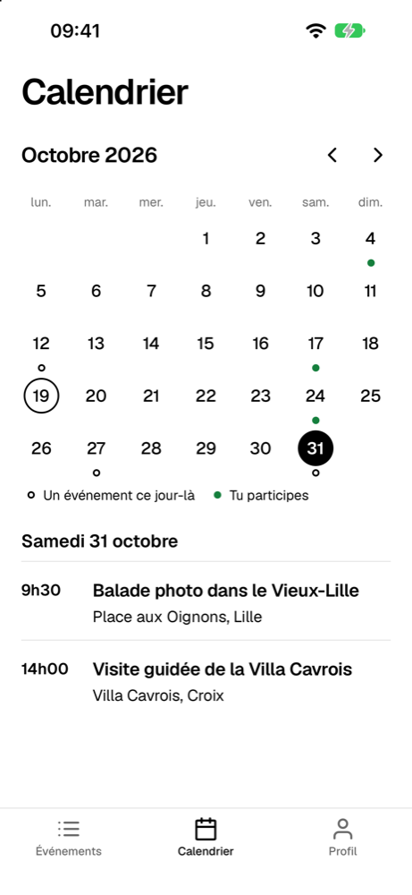

<p align="center"></p>

# EventEase

[](https://github.com/Jeeiib/EventEase/actions/workflows/ci.yml)


EventEase est une application mobile qui permet aux membres et aux bénévoles d'une association de consulter ses événements, d'en créer, de les modifier et d'indiquer ceux auxquels ils participent, avec toutes les données stockées sur le téléphone.

- [Démarrage rapide](#démarrage-rapide)
- [Captures](#captures)
- [Fonctionnalités](#fonctionnalités)
- [Comptes de démonstration](#comptes-de-démonstration)
- [Scripts](#scripts)
- [Stack](#stack)
- [Architecture](#architecture)
- [Qualité](#qualité)
- [Builds](#builds)
- [Limites connues](#limites-connues)
- [Crédits](#crédits)
- [Auteur](#auteur)

## Démarrage rapide

Prérequis : Node 24 et l'application Expo Go 57 sur le téléphone.

```bash
npm ci
npx expo start
```

Scanner ensuite le QR code affiché dans le terminal avec Expo Go, puis se connecter avec un [compte de démonstration](#comptes-de-démonstration).

Sur un réseau qui isole les appareils entre eux (Wi-Fi public, d'école ou d'entreprise), le téléphone ne joint pas l'ordinateur : lancer alors `npx expo start --tunnel`.

## Captures

<p align="center">
  
  
  
  
</p>

## Fonctionnalités

### Cahier des charges

- Inscription et connexion en local, sans serveur : le mot de passe est salé puis haché, la session est conservée entre deux lancements.
- Liste des événements avec titre, extrait de la description, date et lieu, en deux vues (« À venir » et « Passés ») et un filtre « Mes participations ».
- Création, modification et suppression d'un événement. Seul l'auteur peut le modifier ou le supprimer, et la suppression demande une confirmation.
- Participation : un bouton à bascule sur chaque fiche, un badge « Tu participes » dans la liste et le nombre de participants.
- Persistance locale dans une base SQLite, avec un schéma versionné.

### Bonus

- Calendrier mensuel (`react-native-calendars`) : les jours qui ont des événements sont marqués, et un jour touché affiche ses événements.
- Météo du jour de l'événement (Open-Meteo), pour les événements qui ont un lieu et qui ont lieu dans les 15 prochains jours.
- Identité visuelle propre : logo, couleurs, police Geist, icônes Feather, icône d'application et écran de lancement.
- Lieu et distance : un lieu facultatif par événement, et la distance à vol d'oiseau depuis la position de l'utilisateur, demandée seulement quand il touche le bouton.

### Finitions

- Ajout de l'événement au calendrier du téléphone, par la feuille native.
- Itinéraire : le lieu s'ouvre dans l'application de cartes du téléphone.
- Suggestions d'adresse pendant la saisie du lieu.

## Comptes de démonstration

Au premier lancement, l'application crée quatre comptes et des événements passés et à venir, dont les dates sont calculées à partir du jour de ce lancement. Le mot de passe est le même pour tous : `demo2026`.

| Nom           | E-mail                     |
| ------------- | -------------------------- |
| Marie Lefèvre | `marie.lefevre@exemple.fr` |
| Paul Martin   | `paul.martin@exemple.fr`   |
| Sophie Dubois | `sophie.dubois@exemple.fr` |
| Julien Moreau | `julien.moreau@exemple.fr` |

Pour revenir à ce jeu de démonstration, faire un appui long sur le numéro de version, en bas du profil, puis confirmer : la base est vidée et le jeu est recréé avec des dates recalculées.

## Scripts

| Commande               | Rôle                                                |
| ---------------------- | --------------------------------------------------- |
| `npm start`            | Lance le serveur de développement Expo              |
| `npm run ios`          | Lance Expo et ouvre le simulateur iOS               |
| `npm run android`      | Lance Expo et ouvre l'émulateur Android             |
| `npm run lint`         | Analyse le code avec ESLint                         |
| `npm run typecheck`    | Vérifie les types avec TypeScript (`tsc --noEmit`)  |
| `npm test`             | Lance les tests Jest                                |
| `npm run format`       | Met en forme le code avec Prettier                  |
| `npm run format:check` | Vérifie la mise en forme sans modifier les fichiers |

## Stack

| Domaine              | Choix                                                       |
| -------------------- | ----------------------------------------------------------- |
| Application          | Expo SDK 57, React Native 0.86, React 19, TypeScript strict |
| Navigation           | React Navigation 7 (pile native et onglets)                 |
| Données              | `expo-sqlite`                                               |
| Authentification     | `expo-crypto` (sel aléatoire et SHA-256)                    |
| Internationalisation | i18next, react-i18next, `expo-localization`                 |
| Calendrier           | `react-native-calendars`                                    |
| Tests                | Jest avec `jest-expo`                                       |
| Qualité              | ESLint, Prettier, GitHub Actions                            |

## Architecture

```text
src/
  db/          connexion SQLite, migrations versionnées, jeu de démonstration
  data/        accès aux données, un fichier par table (users, events, participations, settings)
  services/    authentification, météo, adresses, localisation, cartes, calendrier du téléphone
  auth/        contexte de session
  navigation/  pile d'authentification, onglets, pile principale
  screens/     un écran par fichier
  components/  composants d'interface réutilisables
  hooks/       chargement des données d'un écran (liste, fiche, météo, distance)
  theme/       couleurs, typographie, chargement de la police
  i18n/        ressources françaises et configuration d'i18next
  utils/       dates, distance, validation, regroupement des événements
```

Les écrans n'écrivent pas de SQL : ils passent par `data/`. Les choix et leurs raisons sont détaillés dans [docs/architecture.md](docs/architecture.md).

## Qualité

- **Intégration continue** : `ci.yml` s'exécute à chaque pull request et à chaque push sur `main`. Il installe les dépendances (`npm ci`), contrôle qu'elles sont celles du SDK (`npx expo install --check`, `npx expo-doctor`), puis lance ESLint, la vérification Prettier, `tsc --noEmit` et Jest.
- **Tests** : 24 suites Jest, sur la logique pure (dates, distance, validation), la couche de données, la base, les services, l'internationalisation et un composant.
- **Accessibilité** : rôles, libellés et états pour VoiceOver sur les éléments tactiles, cibles d'au moins 44 pt, Dynamic Type (les écrans défilent et le texte passe à la ligne), contrastes conformes à WCAG AA.
- **Internationalisation** : i18next dès le départ, tous les textes passent par `t()`, libellés d'accessibilité compris. Une règle ESLint refuse les textes visibles écrits en dur.

## Builds

Les builds se font en local avec `eas build --local` : la compilation tourne sur la machine, sans passer par les serveurs d'EAS. Le projet doit être lié une fois à un compte Expo (`npx eas-cli login`, puis `npx eas-cli init`).

```bash
# APK Android (JDK 17 et SDK Android requis), arm64 seulement pour un fichier deux fois plus léger
npx eas-cli build --local --platform android --profile preview --output EventEase.apk

# Application pour le simulateur iOS (Xcode requis)
npx eas-cli build --local --platform ios --profile preview --output EventEase-simulateur.tar.gz
```

Le profil `preview` est décrit dans `eas.json`. Le premier build Android demande de créer le keystore de signature, en mode interactif.

## Limites connues

- Dans Expo Go, l'icône et l'écran de lancement affichés sont ceux d'Expo Go : seul un build montre ceux d'EventEase.
- Les données restent sur l'appareil : il n'y a ni serveur ni synchronisation, ce qui correspond au cahier des charges. Un compte créé sur un téléphone n'existe pas sur un autre.

## Crédits

- Météo : [Open-Meteo](https://open-meteo.com), données sous licence [CC BY 4.0](https://creativecommons.org/licenses/by/4.0/) (attribution requise).
- Adresses : [Géoplateforme de l'IGN](https://cartes.gouv.fr/aide/fr/guides-utilisateur/utiliser-les-services-de-la-geoplateforme/geocodage/), sous [Licence Ouverte Etalab 2.0](https://www.data.gouv.fr/pages/legal/licences/etalab-2.0).
- Police : [Geist](https://vercel.com/font), sous licence SIL OFL.
- Icônes : [Feather](https://feathericons.com).

## Auteur

Jean-Baptiste, formation Concepteur Développeur d'Applications (CDA), 2026.
